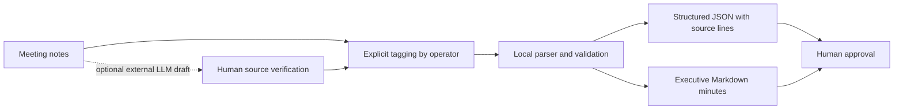

# Architecture

`parse(text)` is a deterministic pure function. It preserves evidence from each tagged line, keeps ambiguous lines for review, and leaves absent owners and due dates unknown. `render(result)` formats Markdown, and the CLI reads local files and emits the selected format to stdout. It does not infer commitments or create external tasks. An optional LLM step is a design proposal only; source verification is a human responsibility. If a transcript is converted to tagged notes, evidence line numbers refer to that intermediate file. Do not publish actual transcripts or minutes. Future work: validated structured LLM adapter, original-transcript span references, reviewer approvals, and benchmark sets for decision/action extraction precision and recall. No model benchmarks have been run.
